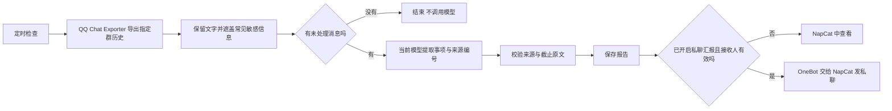

# 群消息整理与私聊推送

当前实现是“定时批量读历史 → 只分析新增文字 → 保存带依据的事项 → 按设置私聊推送”。它不把群里的每条消息立即交给模型。

## 从群消息到报告

### 1. 定时读取

运行时每秒执行一次调度循环，群通知任务最多每分钟进入一次。每个群另有自己的整理间隔，默认 120 分钟。机器人正在处理聊天时，后台整理会暂缓。

读取历史依赖本机 **QQ Chat Exporter**。程序调用其 `127.0.0.1:40653` 导出接口，指定群号和时间范围，然后等导出任务完成。默认回看 7 天，最多选最近 200 条可用文字；可配置回看 1–30 天、最多 20–500 条。

系统消息、撤回消息和机器人自身消息被过滤。历史图片、语音、视频和附件不会在批量整理中下载并理解。邮箱、手机号、明显的密码或 Token 字样会做简单遮盖，但这不是完整的隐私识别系统。

实现：`src/runtime.mjs` 的 `tick()`；`src/history-digest.mjs` 的 `QceExporter.export()`；`src/notice-monitor.mjs` 的 `noticeSamples()`。

### 2. 只处理新增文字

每条消息用“消息 ID 或时间 + 原文”计算 SHA-256 指纹，再与该群的 `processed` 列表比较。没有新指纹就结束，不发起模型请求。

有新增时，选取总计不超过 30,000 字符的样本，编号为 `m1`、`m2`。每条文字本身最多保留 1,200 字符。默认每个到期的群在一轮中发起一次模型请求，使用当前选择的 Codex 或兼容 API。

这属于有界指纹去重，不是语义去重。同样一句话由不同消息 ID 再次转发，仍可能被视为新消息。指纹记录也会滚动裁剪，不能保证永远识别所有旧消息。

实现：`src/notice-monitor.mjs` 的 `update()`。

### 3. 模型提取，程序校验

模型按关注重点和群场景返回结构化事项：标题、摘要、优先级、截止原文，以及来源编号。每轮最多接受 15 项。

程序检查来源编号是否确实存在。没有有效来源的事项被丢弃；截止短语必须逐字出现在引用消息中，否则清空该字段。报告保留最多四段来源片段，便于回看。

例如，“周五晚八点前交实验报告”可整理成提交事项，同时保留“周五晚八点前”和原消息片段。程序不会把它当成学校平台已提交，也没有实现到截止时间再自动提醒的任务调度。

来源校验只能限制引用和截止短语，不能证明模型摘要一定正确。日期含糊、消息互相冲突时仍需看原文。

实现：`extractNotices()`。

## 私聊推送怎么发送

报告先写入本机，再判断是否发送。必须同时满足：通知整理仍启用、群仍在监测列表、“私聊汇报”已开启、接收 QQ 已填写且未在处理中改变。

发送链为 `NoticeMonitor.deliver()` → `BotRuntime.proxy.send()` → `OneBot.send()` → `send_private_msg` → NapCat → 指定 QQ。长文本按 1,800 字符分段发送。

OneBot 给每次请求附上独立 `echo`，以便匹配 NapCat 返回的结果。收到成功响应后，报告状态记为 `private_sent`；这表示接口确认成功，不表示接收人已读。

失败记为 `private_failed`。后续轮询会在至少五分钟后重试，最多三次发送尝试（含首次）。重试复用已保存报告，不再次调用模型。接收人改变后，不把旧的失败报告转发给新接收人。

它不是严格的“只送达一次”：如果前几段已经发送，后续段失败，重试整个报告可能重复前几段；发送成功而本机尚未保存状态时崩溃，也存在重复窗口。达到重试上限后，应在原生面板查看报告。

## 本机保存哪些状态

| 文件 | 用途 |
| --- | --- |
| `data/notices/state.json` | 每群上次尝试、处理过的消息指纹、已见事项、模型调用数 |
| `data/notices/reports.json` | 最近 100 份报告、来源片段、发送状态与尝试次数 |
| `data/notices/exports/<群号>/` | 历史导出文件 |
| `data/inbox-state.json` | 事项的待处理、已完成、已归档状态 |

收件箱状态独立保存，不改写原始报告。把事项标为完成不会在群里回复，不代表学校作业已经提交，也不会自动取消其他系统中的提醒。

报告接收人可以私聊问“最近有什么”或“历史记录有什么”。程序直接读已保存报告回答，不重新导出，不再调用模型；其他 QQ 不能通过这条私聊入口查看报告。

## 使用条件与边界

- NapCat 已登录，机器人 OneBot 连接正常。
- QQ Chat Exporter 已运行，并能导出所选群历史。
- 在群通知模块填写监测群、关注重点和整理间隔。
- 开启“私聊汇报”并指定接收 QQ，才会主动发送。
- 通知整理和私聊汇报默认都关闭。
- 监测列表中的群始终禁止机器人发言，包括被 @。暂停整理仍保留禁言，移出列表才恢复普通群规则。
- 第一次整理会检查回看范围内的历史，因此可能生成一批已有通知。
- 新消息超过条数上限，或旧历史超出时间窗口时，可能漏读。新账号也只能读取 QQ 实际允许访问的历史。
- 这里的群通知整理与“群历史背景摘要”是两个独立任务，后者用于聊天上下文，不负责通知推送。

默认设置来自 `src/settings.mjs`；发送与接收权限见 `src/notice-monitor.mjs`、`src/runtime.mjs` 和 `src/onebot.mjs`。
