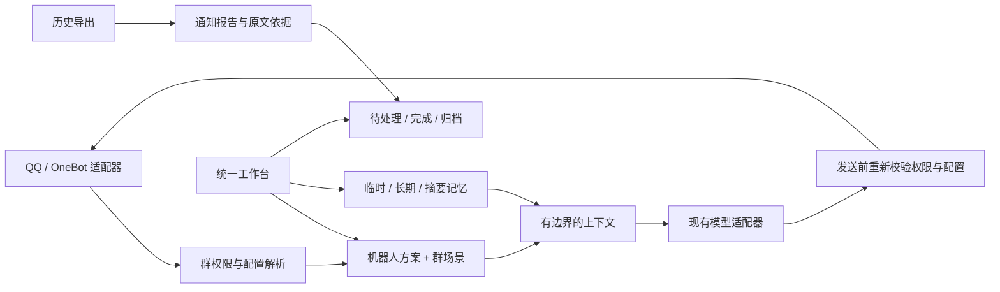

# QQ Agent 工作台改造方案

**Last Updated:** 2026-10-21

> 2.0.0 当前实现：设置 v3 通过 `accounts`、`profiles`、`bindings` 分离 OneBot 账号、人格及群聊/私聊绑定；记忆按账号、人格和会话隔离。原生界面增加相应分类，通知分为按账号的在线实时提醒与默认账号的 QCE 定时历史报告。主人私聊工具代理默认关闭，写入需独立开关、完整预览及一次性确认。当前可用配置见 [账号与人格](ACCOUNT-PERSONAS.md)、[配置手册](CONFIGURATION.md)、[2.0.0 候选说明](releases/v2.0.0.md)。
>
> **下面为历史设计记录**，其中自绘工作台及单账号描述不作为 2.0.0 当前操作指南。

> 1.3.0 界面决策更新：根据用户反馈，用户界面改为直接复用 NapCat 原生配置面板；下文的 1.2.0 自绘工作台视觉方案已被取代。保留领域服务、方案、群策略、分层记忆与收件箱数据架构。具体界面与原生控件边界见 [1.3.0](releases/v1.3.0.md)。

## 要解决的问题

桌面入口、独立网页和 NapCat 嵌入页各自设计，造成不同的品牌、导航、控件与保存方式。后端围绕一个机器人配置持续加字段，群权限、通知监测、临时上下文、长期笔记与历史摘要缺少明确边界。自动摘要和手工编辑甚至写入同一文件而没有共享并发控制。

本次采用渐进式模块化单体：继续使用 Node ESM、OneBot 和现有 JSON 数据，通过明确的领域服务、版本迁移和统一管理界面建立扩展点。避免在界面修复中强行换前端框架或引入数据库部署要求。

## 参考与取舍

| 官方参考 | 借鉴 | 本项目落地 |
| --- | --- | --- |
| [Koishi 服务与依赖](https://koishi.chat/zh-CN/guide/plugin/service) | 服务边界、能力声明、适配器与业务分离 | 模块注册表、集中群策略、运行时装配 |
| [LangGraph Memory](https://docs.langchain.com/oss/javascript/concepts/memory) | 会话短期状态与跨会话长期记忆分离，命名空间隔离 | 临时上下文、分类长期笔记、可追溯摘要分层管理 |
| [Open WebUI Models](https://docs.openwebui.com/features/workspace/models/) | 基础模型之上的可复用指令与模型预设 | 可复用机器人方案，各群绑定方案并补充场景规则 |
| [LangGraph 状态设计](https://docs.langchain.com/oss/javascript/langgraph/thinking-in-langgraph) | 原始状态与呈现分离 | 通知报告保留依据，收件箱状态另存，不改写原文 |

上述是架构借鉴，本项目不声称兼容这些项目的插件协议，也不把它们作为新增运行依赖。

## 领域与执行链



- **机器人**：保留当前默认身份与模型；新增可复用方案，包含名字、系统提示词和可选模型覆盖。群绑定方案；空绑定继承默认配置。方案不授予资源权限，也不切换计费后端。
- **群组**：集中解析允许回应、只读监测、历史上下文、机器人方案和输出模板；只读监测优先于允许回应。监测列表中的群即使暂停整理也继续禁言。
- **记忆**：临时对话保持现有 TTL；长期笔记增加类型、标签、启停、来源与方案范围；自动摘要与手工覆盖分开保存，共享写入串行化。清空手工摘要不能被自动任务悄悄恢复。
- **消息整理**：原始通知报告不可被状态操作改写。收件箱将报告条目投影成稳定 ID 的事项，单独持久化待处理、完成、归档状态，保留来源和截止原文。
- **自定义与扩展**：声明式模块目录提供名称、能力与导航；统一策略决定生效行为。新增能力应有服务接口和测试，避免向消息处理函数持续叠条件。

## 实施契约

配置保留乐观并发 revision 和旧字段，升级至 version 2。旧配置按顺序迁移，不清除凭据、不重建 QQ 登录，不直接改用户数据。

新增 `settings.profiles`：

```json
[{ "id": "study", "name": "学习助手", "systemPrompt": "先给直观例子。", "model": "" }]
```

群记录新增 `profileId`，空字符串代表默认。方案 ID 为 1–40 位字母、数字、下划线、连字符；最多 50 个；删除仍被群引用的方案应拒绝。`model` 留空继承当前后端模型。

现有记忆接口继续兼容 `{scope,text}`，新增可选 `kind`（fact/preference/instruction）、`tags`、`enabled`，增加 `profile:<id>` 范围。旧笔记在读取时补默认元数据，只有用户写入时持久化。

新增管理接口：

- `GET /api/workspace`：模块目录、方案与群生效策略的只读投影。
- `GET /api/inbox`：`{items,counts}`，每项包含稳定 `id`、报告/群/条目身份、正文、依据、时间、状态。
- `PUT /api/inbox/item`：`{id,status}`；status 为 pending/done/archived。

接口沿用原有会话、CSRF、Origin 与 NapCat bridge 授权和固定路由白名单。NapCat 插件配置沿用本机管理员权限，各模块入口的导航范围不构成独立用户权限系统。

## 统一界面

产品品牌统一为 QQ Agent，机器人自定义名称作为当前身份显示。导航为机器人、群组、记忆、消息整理、自定义、服务连接。独立页面使用侧栏，嵌入核心使用同等级页签，单服务插件省略重复页签。

视觉使用实色工作台：背景 `#f4f6f8`、表面 `#ffffff`、正文 `#182230`、次级文字 `#526173`、边线 `#dbe2ea`、强调蓝 `#2457d6`。桌面与网页采用相同语义变量、4/8px 间距、8–12px 圆角和 Segoe UI / Microsoft YaHei 字体；无外部字体依赖。深色模式单独映射语义颜色，NapCat 嵌入页同步宿主明暗模式，业务控件保持工作台规范。SVG 线性图标统一笔画。

页面使用一致的标题、工具栏、列表、详情与保存区。群与记忆提供搜索/筛选；高级配置渐进展开；错误、加载、空状态和未保存状态可见。保留现有表单选择器和桌面宿主协议。

## 验收

1. 旧配置无损迁移；并发保存冲突返回 409；旧接口与插件包继续工作。
2. 方案确实影响对应群请求；其他群与私聊不串配置；在途配置变更不发送旧答案。
3. 记忆作用范围、禁用过滤、旧笔记读取、手工摘要与后台更新并发有测试。
4. 收件箱状态可持久化、撤回完成和归档；原文报告不变；接口拒绝非法状态。
5. 现有自动化测试通过；独立与嵌入 UI 在桌面/375px、浅色/深色有浏览器检查。
6. 测试使用隔离数据和假适配器，不发送真实 QQ 消息、不发起付费模型请求。

## 后续扩展边界

本次的多个机器人方案共用一个 QQ 连接。真正同时多账号运行需要下一阶段把 transport、队列、去重、成员缓存、会话与存储命名空间全部按 botId 隔离。向量检索、跨设备同步、第三方动态插件执行和多流程编排亦需独立设计与验收，不以空壳开关冒充已实现能力。
